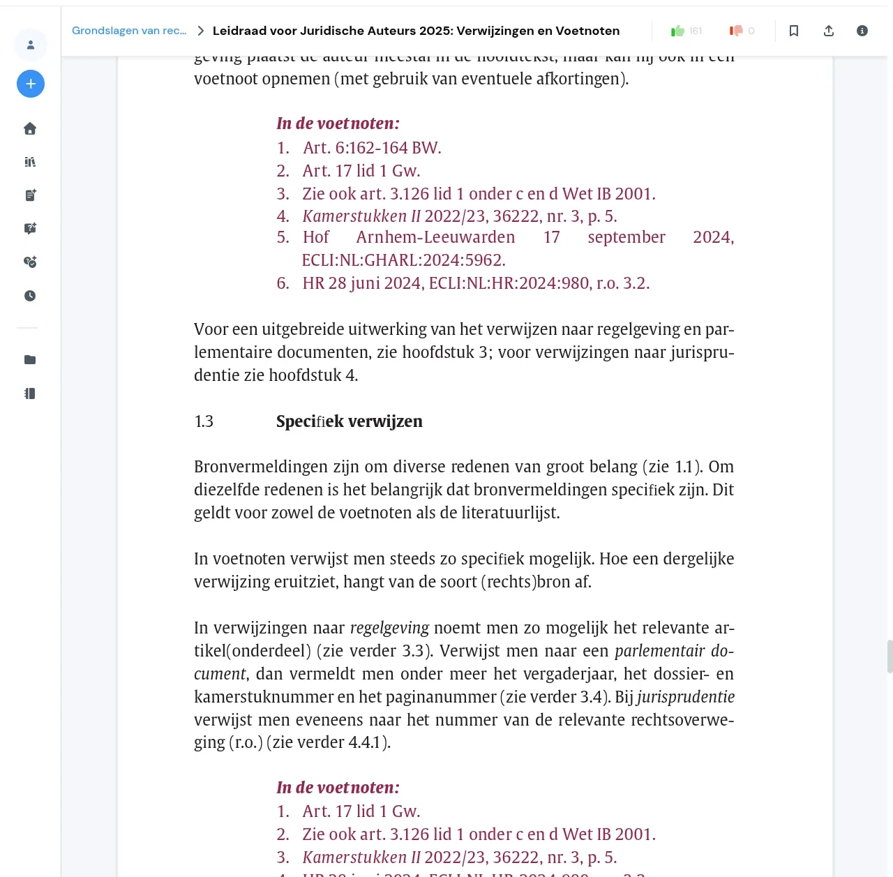

# DocuSave

Tiện ích trình duyệt cho [studocu.com](https://www.studocu.com), [studeersnel.nl](https://www.studeersnel.nl), [studocu.vn](https://www.studocu.vn) và [studocu.id](https://www.studocu.id): xoá làm mờ bản cao cấp, dọn các khối mời nâng cấp trên tài liệu và cho phép tải toàn bộ tài liệu thành một file PDF.

Hoạt động trên Chrome, Brave, Edge và Firefox 142 trở lên (Manifest V3). Không cần tài khoản, không có máy chủ, không thu thập dữ liệu.

Trang dự án: <https://docusave.yangio.id.vn/>



## Tính năng

- Xoá làm mờ trên mọi trang mà Studocu thực sự gửi nội dung về trình duyệt.
- Dọn banner, huy hiệu, nút "Nâng cấp" và hộp thoại che tài liệu.
- Thêm nút **Tải xuống** để chụp toàn bộ trang (chữ và hình) và in cả tài liệu ra PDF.
- Tự tải mọi trang khi mở tài liệu để bạn không phải cuộn qua từng trang.
- Ẩn quảng cáo (Refinery89, Google Publisher Tag, Adagio) và thanh công cụ "Đặt câu hỏi" của AI.
- Có thể tắt từng tính năng trong popup, hoặc tắt toàn bộ tiện ích bằng công tắc chính.
- Tự xoá cookie của các trang Studocu sau mỗi lần truy cập, kể cả khi tiện ích đang tắt, để trang "Access Blocked" không bị kẹt. Đổi lại, bạn sẽ bị đăng xuất khỏi Studocu.

## Những gì không thể làm

Studocu dựng một PDF gốc thành hai lớp cho mỗi trang: một ảnh nền chứa hình vẽ (đường kẻ, viền bảng, ô màu) và một lớp chữ HTML đặt đè lên. Hai lớp được cấp quyền riêng, và với tài liệu trả phí, Studocu không gửi lớp chữ của các trang bị khoá về trình duyệt. Không tiện ích nào có thể xoá làm mờ những trang đó, vì nội dung chữ không hề có trên máy bạn.

Những trang như vậy vẫn giữ bản xem trước bị làm mờ của Studocu và được gắn nhãn "Trang N bị khoá bản cao cấp" trong trình xem và trong bản tải xuống, để bạn phân biệt với trang lỗi. Mọi trang mà Studocu có gửi chữ đều được mở đầy đủ. Console của trình duyệt liệt kê chính xác những trang không thể khôi phục.

Chi tiết kỹ thuật nằm trong [docs/ARCHITECTURE.md](docs/ARCHITECTURE.md).

## Cài đặt

Tải bản mới nhất từ [trang phát hành](https://github.com/thangvt-food/docusave/releases). Mỗi bản có một file `.zip` dùng cho Chrome, Brave, Edge và Firefox.

### Chrome, Brave, Edge

1. Tải `docusave-vX.Y.Z.zip` và giải nén vào một thư mục bạn muốn giữ.
2. Mở `chrome://extensions` (Brave: `brave://extensions`, Edge: `edge://extensions`).
3. Bật **Developer mode** ở góc trên bên phải.
4. Bấm **Load unpacked** và chọn thư mục vừa giải nén (thư mục có file `manifest.json`).

Để cập nhật, tải file zip mới, giải nén đè lên thư mục cũ rồi bấm biểu tượng tải lại trên thẻ tiện ích.

### Firefox

1. Tải `docusave-vX.Y.Z.zip` và giải nén vào một thư mục bạn muốn giữ.
2. Mở `about:debugging#/runtime/this-firefox`, bấm **Load Temporary Add-on...** rồi chọn file `manifest.json` trong thư mục vừa giải nén.
3. Mở một tài liệu Studocu, bấm biểu tượng mảnh ghép trên thanh công cụ, mở phần cài đặt của tiện ích và chọn **Always Allow on studocu.com** (và trên studeersnel.nl, studocu.vn hoặc studocu.id nếu bạn dùng).

Bản phát hành không kèm `.xpi`; Firefox chỉ nạp tạm và tiện ích sẽ mất khi đóng trình duyệt. Nếu cần cài lâu dài, hãy tự ký qua Mozilla Add-ons hoặc dùng Firefox Developer Edition/Nightly với `xpinstall.signatures.required` đặt thành `false`.

## Sử dụng

### Tải tài liệu

1. Mở tài liệu và **đợi Studocu tải xong** — các trang đã hiện nội dung và quá trình tự tải trang đã chạy xong — rồi bấm nút **Tải xuống** màu xanh phía trên các trang. Bấm quá sớm có thể làm bản xem trước thiếu trang hoặc thiếu chữ; nếu lỡ bấm sớm, hãy đóng bản xem trước, tải lại trang và thử lại.
2. Bản xem trước mở ra ngay trong tab hiện tại và tự chụp từng trang. Bạn sẽ thấy "Đang chụp trang X / N" rồi "Đang nhúng ảnh X / N". Hãy giữ tab ở phía trước: trình duyệt sẽ làm chậm tab nền và quá trình chụp có thể bị treo.
3. Khi xong, bấm **In / Lưu PDF** (hoặc Ctrl+P / Cmd+P) và chọn "Lưu dưới dạng PDF" làm đích.

Nhấn Esc hoặc bấm **Đóng** để thoát bản xem trước.

### Cài đặt

Bấm biểu tượng tiện ích trên thanh công cụ để mở popup. Tại đây bạn có thể tắt nút tải xuống, tự tải trang, ẩn quảng cáo, ẩn thanh công cụ AI, thay logo trang, hoặc tắt toàn bộ tiện ích bằng công tắc chính. Thay đổi được áp dụng ở lần tải trang tài liệu tiếp theo, riêng công tắc chính sẽ tải lại trang ngay.

Ngoài các cài đặt trên, script nền tự xoá cookie của bốn trang Studocu mỗi khi bạn truy cập và khi cài đặt tiện ích. Điều này giúp tránh trang "Access Blocked", nhưng cũng có nghĩa là bạn sẽ không giữ được đăng nhập Studocu.

## Cách hoạt động

Trình xem của Studocu là đầu ra của [pdf2htmlEX](https://github.com/pdf2htmlEX/pdf2htmlEX) được bọc trong một virtual scroller của React. Mỗi trang gồm một ảnh nền và một lớp chữ HTML định vị, cả hai được tải từ CDN bằng URL có chữ ký nằm sẵn trong trang. Tiện ích đọc các tham số đã ký, xác định những trang máy chủ thực sự cho phép tải, lấy asset độ phân giải đầy đủ cho những trang đó và gắn nhãn cho phần còn lại. Phần làm mờ là một bộ lọc CSS; tiện ích gỡ nó và giữ nó bị gỡ khi React render lại.

Bài viết đầy đủ về CDN, mô hình cấp quyền và cách phát hiện trang bị khoá nằm trong [docs/ARCHITECTURE.md](docs/ARCHITECTURE.md).

## Phát triển

```
git clone https://github.com/thangvt-food/docusave.git
cd docusave
npm install
npm test          # unit và fixture test (node --test + jsdom)
npm run lint      # web-ext lint trên src/
npm run build     # dist/docusave-vX.Y.Z.zip
```

Bạn có thể nạp thư mục `src/` làm tiện ích chưa đóng gói để chạy bản đang sửa, hoặc dùng `npm run start:firefox` / `npm run start:chromium` để web-ext mở trình duyệt với tiện ích.

Cấu trúc thư mục:

```
src/                mã tiện ích (phần được đóng gói)
  manifest.json
  background.js     xoá cookie của các trang khi truy cập và khi cài đặt
  content/          content script, nạp theo thứ tự trong manifest:
    common.js         namespace dùng chung: selector, mô hình truy cập, cài đặt
    cleanup.js        banner, huy hiệu, nút gốc của trang, logo
    pages.js          xoá làm mờ, tải trang, phát hiện trang bị khoá
    download.js       overlay tải xuống
    main.js           observer và timer điều khiển các phần trên
    style.css         nạp trước khi script chạy
  popup/            popup cài đặt trên thanh công cụ
test/               các bộ test node --test với fixture jsdom
scripts/            build
docs/               ghi chú kiến trúc
site/               trang dự án, xuất bản nguyên trạng lên GitHub Pages
```

Xem [CONTRIBUTING.md](CONTRIBUTING.md) để biết cách báo selector bị hỏng, thêm bản sửa và quy trình phát hành.

## Báo lỗi

Mở một [issue](https://github.com/thangvt-food/docusave/issues/new/choose). Mẫu báo lỗi sẽ hỏi trình duyệt, phiên bản tiện ích, loại tài liệu và các dòng bắt đầu bằng `DocuSave:` trong console. Những dòng đó cho biết trang nào đã khôi phục được và trang nào bị khoá, thường là đủ để chẩn đoán.

Studocu thỉnh thoảng đổi tên class CSS. Khi banner hoặc hiệu ứng làm mờ quay lại sau một đợt cập nhật của trang, cách sửa thường chỉ là thêm một selector mới trong `src/content/common.js` và `src/content/style.css`; pull request cho những trường hợp này luôn được hoan nghênh.

## Ghi công

DocuSave là bản phát triển độc lập dựa trên [StudocuHack](https://github.com/danieltyukov/studocuhack) của Daniel Tyukov, sử dụng theo giấy phép MIT. Thông báo bản quyền gốc được giữ trong [LICENSE](LICENSE); phần ghi công đầy đủ nằm trong [CREDITS.md](CREDITS.md).

## Giấy phép và miễn trừ

MIT, xem [LICENSE](LICENSE).

Dự án không liên kết và không được Studocu bảo trợ. Tiện ích được phát hành cho mục đích học tập; bạn tự chịu trách nhiệm tuân thủ điều khoản sử dụng của các trang bạn dùng.
